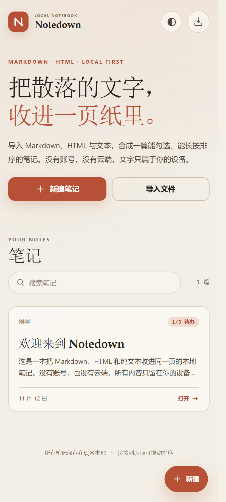
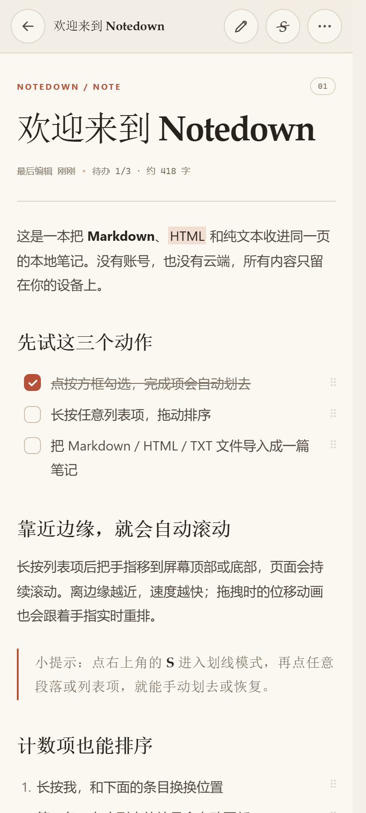
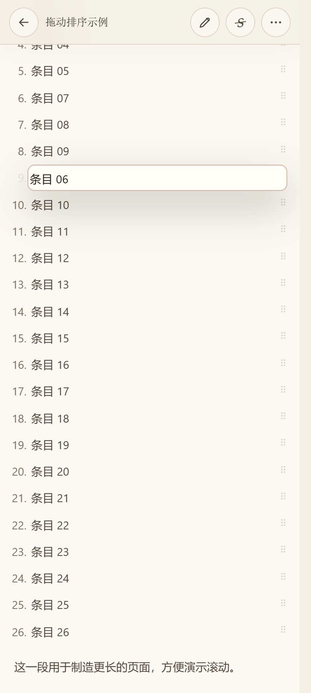
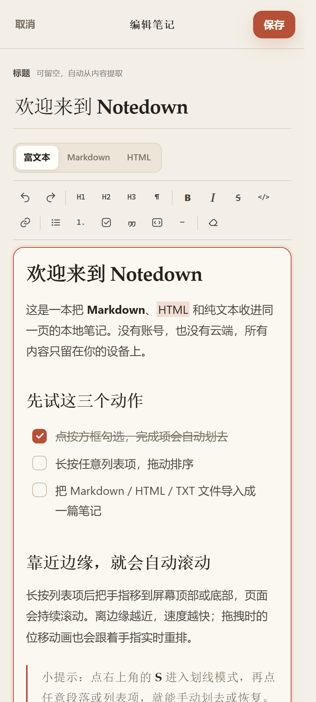
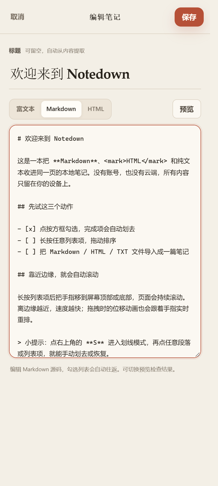

# Notedown

**把散落的文字，收进一页纸里。**

一个 Android 本地笔记应用：导入 Markdown、HTML 与纯文本，合并成一篇可勾选、可划线、可长按拖动排序、也能直接编辑的笔记。没有账号，没有同步服务，内容只保存在设备上。

[](LICENSE)

<p align="center">
  
  
  
</p>

## 功能

- **两种格式，一本笔记**：原生解析 Markdown（GFM）和 HTML，也支持 `.txt`。
- **多文件合并**：一次选择多个文件，导入为一篇笔记；之后还能继续追加文件。
- **三种编辑模式**：打开笔记右上角的铅笔按钮，即可选择
  - **富文本**：像 Typora 一样直接点选可见文字修改；工具栏支持标题、粗体、斜体、删除线、行内代码、链接、引用、代码块、有序/无序/任务列表、分割线、撤销、清除格式。
  - **Markdown**：把当前笔记转换成 Markdown 源码编辑，支持预览；完整往返任务列表、表格、删除线、来源标签。
  - **HTML**：直接编辑安全 HTML。
- **勾选与划去**：任务列表勾选后自动划线；单独的划线模式可点按任意段落或列表项切换划去。
- **长按拖动排序**：有序、无序列表都可以长按拖动，松手即保存。序号会随 DOM 顺序自动重排。
- **丝滑拖拽**：拖拽幽灵跟随手指，其他条目使用 FLIP 位移动画；松手后回弹归位。
- **边缘自动滚动**：拖到屏幕上下边缘附近自动滚动。越靠近边缘越快，速度随距离连续变化，并显示边缘渐变提示。
- **本地优先**：笔记写入应用私有目录，无账号、无遥测；断网也能用。
- **可维护的极简架构**：Android 侧只有一个 Activity，界面使用原生 HTML/CSS/JS，不引入前端框架、数据库或 AndroidX。
- **安全 HTML**：所有导入、粘贴和编辑内容都会经过 DOMPurify 白名单净化，脚本、内联样式、事件属性、危险 URL 都会被移除。
- **浅色 / 深色 / 跟随系统**，偏好会持久保存。
- **整理**：标题重命名、搜索、删除确认，以及 Markdown/HTML 预览。

## 技术栈

| 层 | 选型 |
| --- | --- |
| Android 容器 | Java 17，单个 `Activity` + `WebView`，无第三方 Android 依赖，无 AndroidX |
| 界面 | 原生 HTML / CSS / JavaScript，无框架、无构建步骤 |
| 富文本编辑 | 原生 `contenteditable` + 自定义格式工具栏，不引入编辑器框架 |
| Markdown 解析 | [marked](https://github.com/markedjs/marked) 12（本地内置，MIT） |
| HTML → Markdown | [Turndown](https://github.com/mixmark-io/turndown) 7 + GFM 插件（本地内置，MIT） |
| HTML 净化 | [DOMPurify](https://github.com/cure53/DOMPurify) 3.4（本地内置，Apache-2.0 / MPL-2.0） |
| 存储 | 应用私有目录中的原子写入 JSON 文件（`AtomicFile`）；浏览器调试时回退到 `localStorage` |
| 构建 | Gradle 8.11.1 + Android Gradle Plugin 8.9.2，compileSdk 35 / minSdk 26 |

**为什么这样选？** 笔记的核心难点是排版、手势、连续动画与直接编辑。浏览器内核天然擅长这些；用 `contenteditable` 就能把可见文字当作编辑器，不必在 Compose 或 View 层重复实现富文本。Android 壳只负责安全存储、系统文件选择器、震动和返回键。APK 不到 200 KB，打开 Android Studio 或普通浏览器都能调试。

## 安装

到 [Releases](https://github.com/kaminosora/notedown/releases/latest) 下载 `notedown-*-debug.apk`，允许“安装未知应用”后安装即可。

- 支持 Android 8.0（API 26）及以上。
- Release APK 目前使用 Android debug 签名，适合侧载体验，不适合直接上架 Google Play。
- 应用不需要任何运行时权限。导入文件通过系统文件选择器（SAF）完成。

## 本地构建

要求：JDK 17、Android SDK Platform 35、Build-Tools 35.0.0。

```bash
git clone https://github.com/kaminosora/notedown.git
cd notedown
./gradlew :app:assembleDebug
# Windows: gradlew.bat :app:assembleDebug
```

APK 输出到 `app/build/outputs/apk/debug/app-debug.apk`。

如果 SDK 不在默认位置，创建不要提交的 `local.properties`：

```properties
sdk.dir=/path/to/Android/Sdk
```

## 只调试网页层

界面本身可以在桌面浏览器中运行：没有原生桥时会自动使用 `localStorage` 和普通文件选择器。

```bash
python -m http.server 8765 --directory app/src/main/assets/www
```

打开 <http://127.0.0.1:8765/>。这是调整样式和手势最快的方式。

## 自动化测试

浏览器端测试覆盖解析、HTML 净化、富文本直改、格式工具栏、三模式往返、任务、链接、导入合并、长按拖拽、FLIP 动画和自动滚动。

```bash
npm install
npm run test:e2e
```

测试会在空闲端口启动静态服务器，并启动无头 Chrome。找不到浏览器时，请设置 `CHROME_PATH`：

```bash
# Windows PowerShell
$env:CHROME_PATH = "C:\Program Files\Google\Chrome\Application\chrome.exe"
npm run test:e2e
```

测试不依赖 Android SDK；它针对与 APK 内完全相同的 WebView 资源运行。

## 编辑模式说明

<p align="center">
  
  
</p>

- **富文本**：所见即所得。选中文字后点工具栏的格式按钮；任务列表复选框在编辑界面中也可直接点选。粘贴的 HTML 会先净化再插入。
- **Markdown**：打开时由当前安全 HTML 即时转换，保存时再由 marked 转回 HTML。任务勾选状态、列表、表格、链接、删除线和导入来源标签都会保留。
- **HTML**：适合精确控制标签结构；保存时会重新运行安全净化。
- 模式间的切换会先保存当前模式的改动，再转换到目标模式。复杂的自定义 HTML（例如内联样式）在切换时会被规范化。

## 交互细节

- 笔记页右上角的 **铅笔按钮** 直接进入富文本编辑；也可以从 `⋯` 菜单选择“编辑笔记”。
- 富文本工具栏在手机上会自动换行；点击按钮不会收起软键盘，也不会丢失当前选区。
- **长按** 列表项 360 ms 进入拖拽，位移不超过 9 px 前仍可正常滚动页面。
- **FLIP** 动画时长 185 ms，拖拽幽灵使用 `translate3d`，不触发布局抖动。
- **自动滚动** 范围为视口高度的 18%，限制在 88–150 px 内；最大速度 20 px / 60 Hz 帧，越靠近边缘速度按幂函数增长。
- 松手后 185 ms 内回弹到目标槽位，顺序写入存储；勾选与划线也即时保存。
- 划线模式退出方式：再次点右上角 **S**、点提示条中的“完成”，或按返回键。

## 导入规则与边界

| 格式 | 扩展名 |
| --- | --- |
| Markdown | `.md` `.markdown` `.mdown` `.mkd` |
| HTML | `.html` `.htm` `.xhtml` |
| 纯文本 | `.txt` `.text` |

- 单次最多 **20 个文件**；单文件最多 **1.5 MB**；单次合计最多 **6 MB**。
- 文本优先按 UTF-8 解码；非法 UTF-8 时自动按 GB18030 解码。带 BOM 的 UTF-8 / UTF-16 也能识别。
- 导入 HTML 仅保留语义标签和文本；样式表、脚本、事件属性会被移除。这是为了防 XSS，因为页面里存在原生文件桥。
- HTML/Markdown 中引用相对路径的本地图片不会被打包；`https://` 远程图片可以显示，`data:image/...` 内联图片也可显示。
- 长按拖动只在同一个列表（同一个 `<ul>` / `<ol>`）内排序；不跨列表搬移。
- 数据保存在应用私有目录 `files/notes.json`。卸载应用不会保留，也没有云端恢复。

## 目录结构

```text
app/src/main/
├── AndroidManifest.xml
├── java/.../MainActivity.java   # WebView 壳、文件选择器、原生桥、主题与返回键
├── assets/www/
│   ├── index.html
│   ├── css/app.css
│   └── js/
│       ├── parser.js            # Markdown/HTML → 安全规范化 HTML
│       ├── export.js            # 安全 HTML → Markdown（含任务/来源标签）
│       ├── store.js             # 本地 JSON 存储
│       ├── drag.js              # 长按拖拽、FLIP、边缘自动滚动
│       ├── app.js               # 界面、编辑模式与格式工具栏
│       └── vendor/              # marked + DOMPurify + Turndown（含许可证）
└── res/                         # 主题、图标
tests/e2e.mjs                    # 浏览器端到端测试
```

### 笔记数据约定

界面内部使用安全的语义 HTML 保存，额外属性只有四个：

```html
<li data-task="true" data-checked="true">任务</li>
<p data-struck="true">手动划去的段落</p>
<div data-file="source.md"></div>
```

控件由 `enhanceContent()` 在显示时重建，保存时会清理，因此存储内容不依赖某个 UI 版本。

## 故障排查

### 启动后立即闪退

1.0.0 在 Android 15 的部分模拟器（已验证 MuMu 12）上，因系统栏初始化早于窗口 DecorView 创建而崩溃。**1.0.1 已修复**，请安装 Releases 中的最新版。

如果安装最新版后仍闪退，请确认模拟器/设备安装了 **Android System WebView**。部分精简版模拟器移除了 WebView；本应用完全依赖它渲染 Markdown / HTML。可在系统设置 → 应用 → Android System WebView 中检查，或在 MuMu 设置中安装/启用 WebView。

## 已知限制

- 富文本编辑基于浏览器 `contenteditable`，极复杂的 Office/网页粘贴结构会被简化为安全语义标签。
- 暂不支持图片附件、导出、云同步；长按拖拽也不会跨列表搬移。
- 自动滚动依赖浏览器 `requestAnimationFrame`；极低端设备上可能略有降帧。
- 使用 debug 签名，因此不能在 Play Store 直接发布；如需正式发布，请配置自己的 release keystore。

## License

代码以 [MIT License](LICENSE) 发布。第三方依赖许可见 [THIRD_PARTY_NOTICES.md](THIRD_PARTY_NOTICES.md)。
